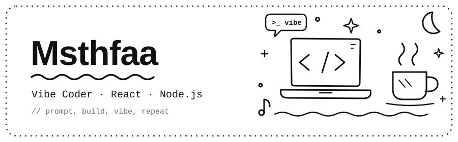

<div align="center">

<picture>
  <source media="(prefers-color-scheme: dark)" srcset="https://raw.githubusercontent.com/Msthfaa/Msthfaa/main/hero-dark.svg">
  
</picture>

<picture>
  <source media="(prefers-color-scheme: dark)" srcset="https://readme-typing-svg.demolab.com?font=JetBrains+Mono&weight=500&size=18&duration=3000&pause=1000&color=F2F2F2&center=true&vCenter=true&width=600&lines=Prompt.+Build.+Vibe.+Repeat.;Pair+programming+with+AI;React+%2B+Tailwind+on+the+frontend;Node.js+%2B+MongoDB+on+the+backend;Ship+first%2C+polish+right+after">
  
</picture>

</div>

<picture>
  <source media="(prefers-color-scheme: dark)" srcset="https://raw.githubusercontent.com/Msthfaa/Msthfaa/main/divider-dark.svg">
  
</picture>

## About

Saya **vibe coder**: membangun produk bareng AI, jalan dengan feeling, dan iterasi secepat mungkin. Tapi vibes tanpa pemahaman itu rapuh, jadi setiap baris kode yang dihasilkan tetap saya baca, uji, dan pahami sebelum di-ship.

| | |
|:--|:--|
| **Mode** | Vibe coding, dibantu AI |
| **Sedang dipelajari** | React, Node.js, Tailwind CSS |
| **Fokus** | Frontend dengan React & Tailwind, REST API dengan Node.js & MongoDB |
| **Terbuka untuk diskusi** | Vibe coding, prompt engineering, Web Development, Open Source |
| **Soundtrack** | Lo-fi beats dan synthwave |
| **Bahan bakar** | Kopi dan sesi coding larut malam |

<picture>
  <source media="(prefers-color-scheme: dark)" srcset="https://raw.githubusercontent.com/Msthfaa/Msthfaa/main/divider-dark.svg">
  
</picture>

## The Vibe Workflow

```text
01  Idea      ->  tulis prompt yang jelas dan spesifik
02  Generate  ->  biarkan AI menyusun draf pertama
03  Review    ->  baca, pahami, dan perbaiki hasilnya
04  Ship      ->  deploy, belajar dari hasilnya, ulangi
```

## Vibe Coder's Rules

- Prompt dulu, ketik belakangan.
- AI yang menulis, saya yang bertanggung jawab. Kode yang tidak saya pahami tidak masuk ke `main`.
- Commit kecil dan sering, supaya mudah di-rollback kalau vibes-nya meleset.
- Playlist harus siap sebelum sesi coding dimulai.
- Kalau error, tarik napas, baca pesan errornya, baru tanya ulang.

<picture>
  <source media="(prefers-color-scheme: dark)" srcset="https://raw.githubusercontent.com/Msthfaa/Msthfaa/main/divider-dark.svg">
  
</picture>

## Tech Stack

**Frontend**&nbsp;&nbsp;


**Backend**&nbsp;&nbsp;


**AI & Tools**&nbsp;&nbsp;


<picture>
  <source media="(prefers-color-scheme: dark)" srcset="https://raw.githubusercontent.com/Msthfaa/Msthfaa/main/divider-dark.svg">
  
</picture>

## GitHub Stats

<div align="center">

<picture>
  <source media="(prefers-color-scheme: dark)" srcset="https://github-readme-stats.vercel.app/api?username=Msthfaa&show_icons=true&hide_border=true&count_private=true&bg_color=0d1117&title_color=ffffff&text_color=c9d1d9&icon_color=ffffff">
  
</picture>
&nbsp;
<picture>
  <source media="(prefers-color-scheme: dark)" srcset="https://github-readme-stats.vercel.app/api/top-langs/?username=Msthfaa&layout=compact&hide_border=true&bg_color=0d1117&title_color=ffffff&text_color=c9d1d9">
  
</picture>

<picture>
  <source media="(prefers-color-scheme: dark)" srcset="https://streak-stats.demolab.com/?user=Msthfaa&hide_border=true&background=0D1117&ring=FFFFFF&fire=FFFFFF&currStreakNum=FFFFFF&sideNums=FFFFFF&currStreakLabel=FFFFFF&sideLabels=C9D1D9&dates=8B949E">
  
</picture>

</div>

<picture>
  <source media="(prefers-color-scheme: dark)" srcset="https://raw.githubusercontent.com/Msthfaa/Msthfaa/main/divider-dark.svg">
  
</picture>

## Let's Connect

<div align="center">

<a href="https://linkedin.com/in/YourProfile"></a>
<a href="https://twitter.com/YourTwitter"></a>
<a href="mailto:youremail@example.com"></a>

<br>

<sub>Vibes in, code out. Mari membangun sesuatu yang keren bersama.</sub>

</div>
